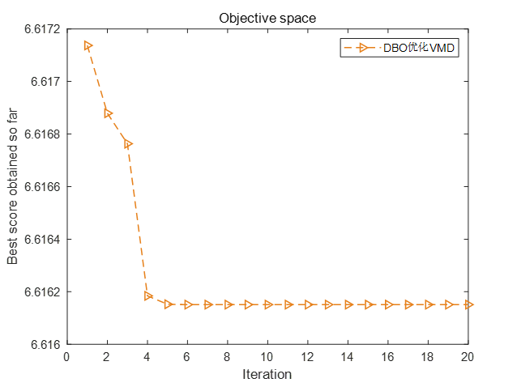
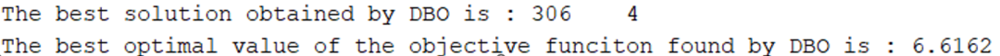
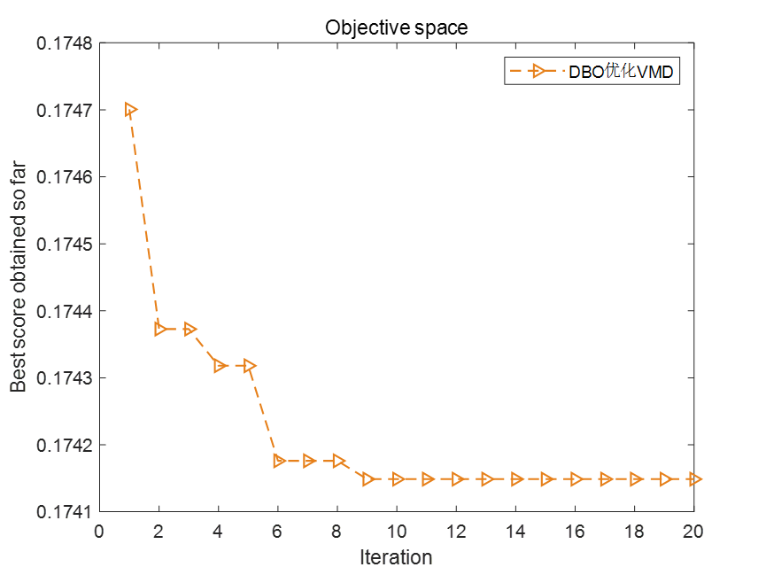
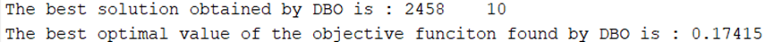
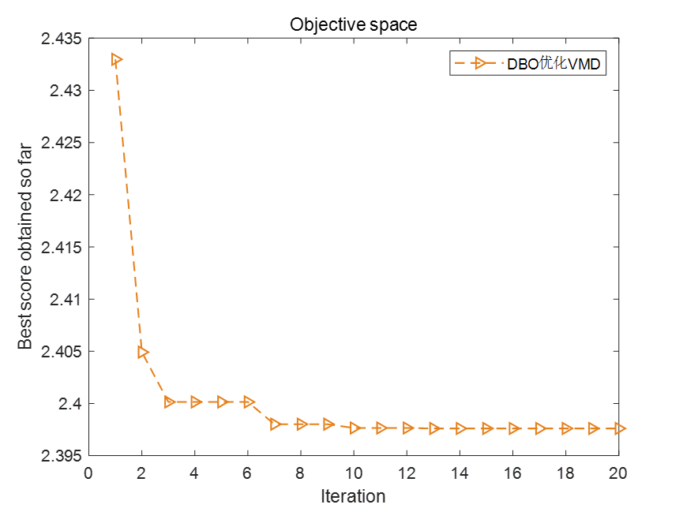
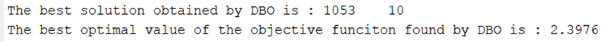
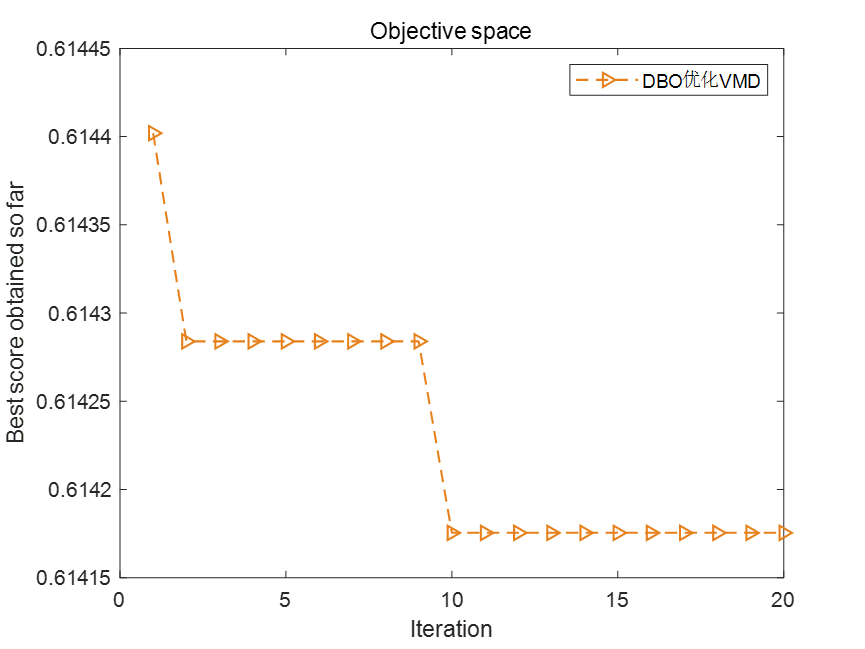
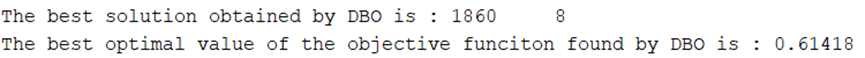

# Optimization of VMDVs using the Dung Beetle Optimization Algorithm (DBO) for VMD parameters. Minimum Entropy Sample entropy Information entropy Permutation entropy (Adaptation function can be selected by oneself. One-click modification) MATLAB

The dung beetle optimization algorithm is developed by the team of Professor Shen Bo from Hua University.,  Following the Sparrow Search Algorithm (Sparrow Search Algorithm, After SSA A novel group intelligence optimization algorithm was proposed again on November 27, 2022. Many scholars have used algorithms in practical engineering problems. Today, let's use the dung beetle optimization algorithm for optimization.VMDParameters. Taking the same example as Xi'an University of Science and Technology dataset, Select 1000 data points from the X105BAtime.mat file in the 105.mat package.
1. Minimum Entropy as the fitness function
2. Minimum sample entropy as the fitness function
3. Minimum Information Entropy as the Fitness Function
4. Minimum Arrangement Entropy as the Fitness Function
Code:

## Images

<!-- PAYMENT_BLOCK -->

## Get this dataset

- Payment link (Stripe): [Buy now](https://buy.stripe.com/3cs8yP7sY87d0vu9AB)
- Payment QR code: 

<!-- /PAYMENT_BLOCK -->
